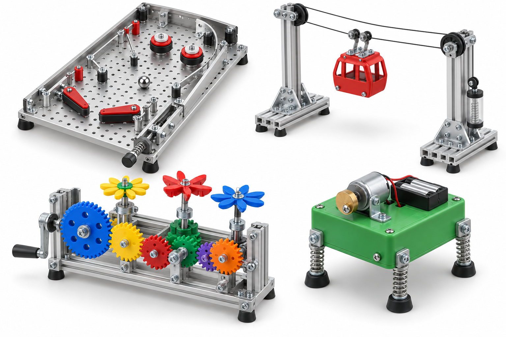

# ME Machine Lab

Open, hands-on mechanical-engineering outreach projects for students who learn by designing, building, measuring, and improving real mechanisms.

> **Design status — rendered concepts, not yet build-ready.** The repository now enforces a no-fabrication release gate: no cutting, drilling, milling, machining, or custom-shaped build pieces. A project may be promoted to a student build only after its *entire* BOM has exact supplier part numbers and a physical pilot has checked fit, containment, and safe operation. See the [no-fabrication build standard](docs/BUILD_STANDARD.md).

## Start here

| Project | What teams build | Typical audience | Activity length | Main engineering idea |
| --- | --- | ---: | ---: | --- |
| [HydroGrab](designs/hydrograb/README.md) | Water-powered tabletop pick-and-place arm | Grades 6–10 | 75–90 min | Force–displacement tradeoff and linkages |
| [Rescue Hoist](designs/rescue-hoist/README.md) | Hand-cranked two-stage gear winch | Grades 7–12 | 90–120 min | Gear ratio, torque, and friction |
| [Crank Critter](designs/crank-critter/README.md) | Crank-driven walking mechanism or automaton | Grades 5–10 | 45–75 min | Degrees of freedom, pivots, and kinematics |
| [Pinball Lab](designs/pinball-lab/README.md) | Reconfigurable, hand-powered mini pinball game | Grades 6–12 | 60–90 min | Energy loss, impacts, and design for play |
| [Cable-Car Dash](designs/cable-car-dash/README.md) | Counterweighted cable car on a bolt-together tower | Grades 6–12 | 60–90 min | Pulleys, counterbalance, and speed control |
| [Gear Garden](designs/gear-garden/README.md) | Colorful hand-cranked kinetic sculpture | Grades 5–12 | 45–75 min | Gear ratios and phase relationships |
| [Springy Wobblebot](designs/springy-wobblebot/README.md) | Battery-powered vibrating creature on spring legs | Grades 5–10 | 30–60 min | Unbalance, vibration, and friction |

## Design philosophy

Every project follows the same cycle: **make a mechanism → measure a result → change one variable → explain the physical reason.** A build is not presented as a validated scientific result; it is a controlled, safe demonstration and design challenge.

Projects are deliberately low-voltage or hand-powered. The common kit is reusable and avoids wood, cut stock, and student-made structural pieces. See [the exact-item ledger and release rule](docs/BUILD_STANDARD.md), [procurement guidance](docs/PROCUREMENT.md), and [safety requirements](docs/SAFETY.md) before purchasing or running an event.

## Catalog-parts toy track

The four projects added above are designed around a reusable **catalog-parts chassis**, rather than wood craft sticks, custom laser-cut pieces, or machined components. Students assemble pre-existing rails, brackets, gears, shafts, bearings, springs, wheels, plastic enclosures, and fasteners. The [catalog-parts toy system](docs/CATALOG_TOY_SYSTEM.md) explains the shared interfaces. The [graphical assembly flow](assets/manuals/catalog-toy-assembly-flow.svg) shows the required no-fabrication method.



*Illustrative concept render only. It is not a geometry-certified CAD model or a substitute for the exact-item BOM and physical pilot required by the build standard.*

## Repository layout

```text
designs/       One folder per activity: BOM, assembly, challenge, and facilitator notes
assets/        Editable SVG mechanism diagrams, graphical manuals, and labeled concept renders
docs/          Common procurement, safety, and event-planning guidance
```

## Contributions

Please open an issue or pull request with a build photo, a measured result, a sourcing substitution, or a correction. Include the student age range, material version, configuration, and observed failure mode so that a proposed design can progress toward a verified one.

## License

Suggested: [CERN-OHL-S v2](https://ohwr.org/cern_ohl_s_v2.txt) for hardware documentation, paired with [CC BY 4.0](https://creativecommons.org/licenses/by/4.0/) for written instructional material. Confirm the intended organizational licensing policy before adding license files.
