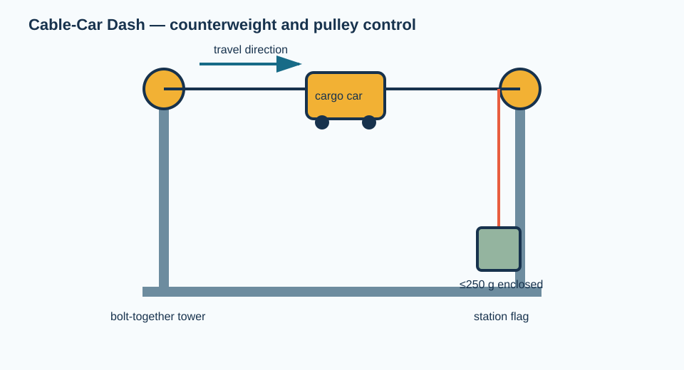
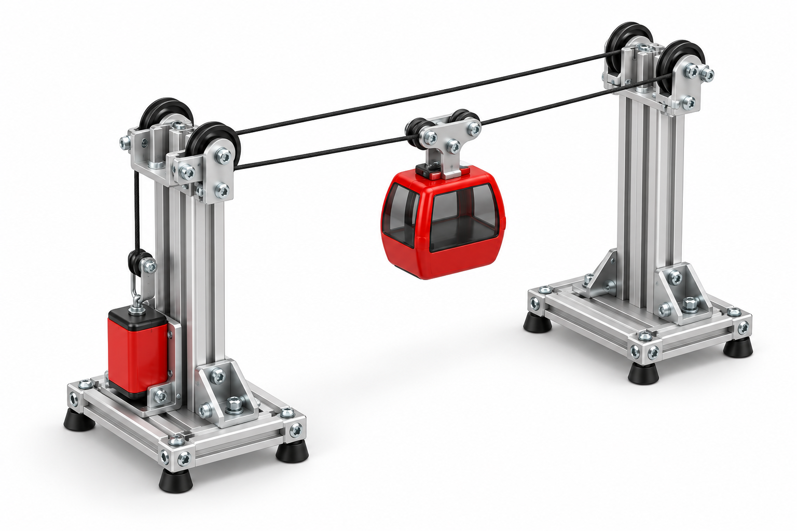

# Cable-Car Dash: counterweighted tower toy

*Illustrative 3D concept render. The purchasable version uses full-length perforated VEX channels, a commercial pulley/rope kit, and a small factory-molded enclosure rather than a custom car body or machined tower.*

Students build two small bolt-together towers, a rolling gondola, and a plate counterweight. The challenge is to carry a light payload to a station without overshoot.

**Status:** procurement-complete rendered concept; **not yet classroom-release ready.** The BOM gives every item necessary to buy the proposed no-fabrication configuration. A first article must verify stability, trolley travel, termination retention, and the protected counterweight envelope before students operate it. See the [build standard](../../docs/BUILD_STANDARD.md).

## What the purchasable version changes

| Rendered feature | No-fabrication implementation |
| --- | --- |
| Custom tower frame | Factory-hole VEX C-channels, chassis rails, gussets, and supplied #8-32 hardware |
| Smooth enclosed cable-car body | McMaster factory-molded polycarbonate enclosure used as the gondola body |
| Individual rope sheaves and cut rope | VEX Winch & Pulley Kit with eight pulleys and a factory-supplied 4-ft rope |
| Loose washer counterweight | One supplied VEX 5x15 steel plate, secured as a single counterweight module |

## Complete bill of materials — one tabletop cable car

| Function | Exact item and purchased configuration | Buy | Use | Direct item link |
| --- | --- | ---: | ---: | --- |
| Towers, bases, trolley plate, counterweight plate, square shafts, bearings, standoffs, #8-32 fastening hardware, and two supplemental angle gussets | VEX V5 `276-2161`, Metal & Hardware Kit | 1 kit | 4 chassis rails; 2 5x15 plates; 4 pillow blocks; 2 angle gussets; hardware as supplied | [276-2161](https://www.vexrobotics.com/276-2161.html) |
| Vertical tower members and base cross-members | VEX V5 `276-2288`, 1x2x1x25 Aluminum C-Channel | 1 pack | 4 full-length channels | [276-2288](https://www.vexrobotics.com/276-2288.html) |
| Tower/base bracing | VEX V5 `276-7761`, 90-degree Gusset Pack | 1 pack | 6 gussets (4 flat, 2 bent) | [276-7761](https://www.vexrobotics.com/276-7761.html) |
| Travel rollers, hand winch, ratchet, and three pre-made ropes | VEX V5 `276-1546`, Winch & Pulley Kit | 3 kits | 4 pulleys for trolley; 2 tower pulleys; 1 winch; 3 factory 4-ft ropes | [276-1546](https://www.vexrobotics.com/276-1546.html) |
| Gondola body with factory mounting features | McMaster-Carr `5257N111`, gray impact-resistant polycarbonate enclosure, 3.75 x 4.5 x 2.25 in. | 1 | 1 | [5257N111](https://www.mcmaster.com/5257N111/) |
| Nonstructural tethering/line retention | VEX V5 `275-0125`, 11-in. zip ties (100-pack) | 1 pack | 6 ties | [275-0125](https://www.vexrobotics.com/275-0125.html) |
| Shared assembly tools | VEX V5 `276-1382`, Tool Kit | 1 shared kit | 1 wrench and 2 hex keys | [276-1382](https://www.vexrobotics.com/276-1382.html) |

**Length correction:** One `276-1546` rope is a factory 4-ft section. The tallest full-channel configuration can require more than 4 ft for the worst-case trolley-to-top-pulley-to-counterweight path, including secure knots. Three kits are therefore specified: one uncut rope is the fixed guide line and two uncut ropes are tied together for the drive line. This uses no cut rope or splice. Do not replace them with a generic pulley-and-rope category; source the same SKU through VEX or an authorized reseller and recheck availability before ordering.

## Item-specific assembly sequence

1. Use two full `276-2288` C-channels as upright tower members and two as bases. Join each upright to its base with four flat `276-7761` gussets; use the two bent `276-7761` gussets and two `276-2161` angle gussets as additional base braces. Join the towers with two `276-2161` chassis rails. Position the bases parallel on a level tabletop; do not clamp the system near an edge.
2. Bolt a `276-2161` pillow block and a `276-1546` pulley at the top of each tower using only factory holes. Keep their centers at equal height. Use the supplied VEX hardware and tighten both tower bases before adding rope.
3. Make the trolley from one supplied 5x15 steel plate, four pulley-kit pulleys, two supplied short shafts, and the supplied shaft collars. Mount the `5257N111` enclosure to the plate through its factory external mounting holes; use spacers from the kit if needed to keep the enclosure clear of the wheels.
4. Tie one uncut, factory 4-ft rope taut between the tower tops as the *guide* line. Put four pulley-kit pulleys on the trolley plate so the trolley captures and rolls along this guide line. Use only the pulley grooves and factory VEX shaft hardware; do not cut, melt, or splice the rope.
5. Join the ends of the second and third uncut, factory 4-ft ropes with a double-fisherman's bend to make the *drive* line; do not cut or splice either rope. Attach one free end to the trolley plate, route it over the pulley at one tower, and attach the other free end to the other 5x15 steel plate, which is the single secured counterweight module. Mount the VEX winch at the counterweight tower so the facilitator can reset the counterweight by hand. Keep it inside the space bounded by the tower bases throughout travel.
6. With the switchless, hand-powered system unloaded, crank slowly through the full travel. Add no more than 50 g payload to the enclosure until the first-article checks are complete.

## First-article checks before release

- With the counterweight at either extreme, the tower bases must remain stable and all moving mass must stay inside the tabletop footprint.
- With a 50 g payload, cycle full travel 20 times; inspect pulley retention, rope abrasion, cable ties, and enclosure fasteners after each five cycles.
- Establish and mark a no-hand zone around counterweight travel and around the winch/ratchet. The counterweight must not be a collection of loose washers.

## Physics prompt

For the proposed one-to-one rope path, a hanging counterweight provides approximately \(m_\mathrm{cw}g\) while the moving inertia is \(m_\mathrm{cw}+m_\mathrm{car}+m_\mathrm{payload}\). Neglecting rope and pulley losses, \(a\approx m_\mathrm{cw}g/(m_\mathrm{cw}+m_\mathrm{car}+m_\mathrm{payload})\). Students should define a positive travel direction, predict the acceleration, then compare with stopping error at each station.
