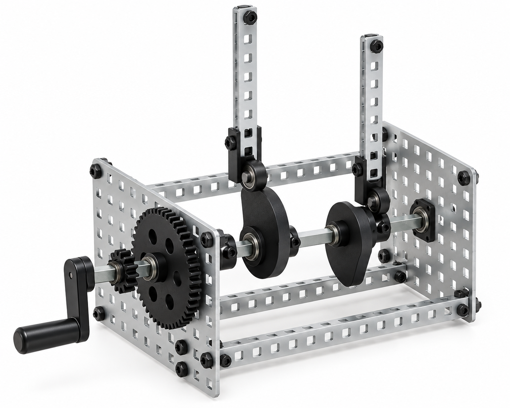

# Crank Critter: dual-cam automaton




*Illustrative, BOM-constrained 3D render of the stock VEX hand crank, cams, followers, gears, factory-perforated frame, and #8-32 fasteners listed below. It is not evidence of a physically tuned automaton.*

## Purpose and challenge

Teams make a hand-cranked tabletop creature/machine whose two cam followers produce repeating, phase-offset motions (for example, a head bob and a tail wave). It is deliberately a **stationary automaton**, not a walking mechanism: that gives students a buildable, no-fabrication route to timing, cam profile, friction, and gear ratio without unsupported craft parts.

**Design status:** exact-catalog redesign drafted; a first article must demonstrate free rotation, follower retention, and a stable frame before classroom release. Low hand torque only; do not motorize it.

## Engineering model

For a cam radius \(r(\theta)\), the follower displacement is set by the change in cam radius as the crank angle \(\theta\) advances. The 12T-to-36T reduction gives an ideal output speed ratio of \(\omega_\mathrm{cam}/\omega_\mathrm{crank}=12/36=1/3\); one cam revolution takes three crank revolutions. Friction, gear backlash, follower contact, and flexible structure make the observed motion depart from that ideal.

## Bill of materials — one automaton

| Item | Exact purchased configuration and use | Qty. used / purchased | Purchase link |
| --- | --- | ---: | --- |
| Frame and fasteners | VEX Robotics **276-2161 Metal & Hardware Kit**; use two 5x15 plates, four 1x25 bars, supplied #8-32 fasteners, bearings, collars, and short square shafts | 1 / 1 kit | [VEX 276-2161](https://www.vexrobotics.com/276-2161.html) |
| Crank, cams, and followers | VEX Robotics **276-2045 Advanced Mechanics and Motion Kit**; use one hand crank, two cams, and two cam followers | 1 / 1 kit | [VEX 276-2045](https://www.vexrobotics.com/276-2045.html) |
| Speed-reduction gears | VEX Robotics **276-2169 Gear Kit**; use one 12T and one 36T 24-DP, 20° gear | 2 / 1 kit | [VEX 276-2169](https://www.vexrobotics.com/gears.html) |
| Shared hand tools | VEX Robotics **276-1382 Tool Kit**; use the supplied hex key/wrench with the kit hardware | shared / 1 kit | [VEX 276-1382](https://www.vexrobotics.com/276-1382.html) |

The VEX frame, shafts, bearings, collars, gear bores, and #8-32 fasteners are a single compatible system. No cardboard, wood, dowels, tape, drilled holes, or cut stock is required.

## Graphical assembly path

```text
hand crank → 12T input gear  ⇄  36T cam-shaft gear → cam A / follower A → head bar
                                                └──→ cam B / follower B → tail bar

two 5x15 plates + 1x25 bars = rigid perforated frame and follower guides
```

1. **Assemble the frame.** Use two 5x15 plates as parallel sidewalls and uncut 1x25 bars as base crossmembers. Bolt through factory holes using the #8-32 hardware from 276-2161. The frame should sit flat before shafts are installed.
2. **Install the crank/input shaft.** Install the 276-2045 hand crank on a short supplied square shaft supported by two kit bearings. Retain it with supplied collars. Fit one 12T gear inside the sidewalls.
3. **Install the cam shaft.** On a second parallel shaft, secure one 36T gear and the two 276-2045 cams so all three rotate together. Mesh the 12T and 36T gears without forcing them together; rotate slowly by hand to confirm one full cam-shaft turn for approximately three input turns.
4. **Guide the followers.** Bolt two 1x25 bars vertically between existing holes as guides. Install one cam follower per cam so it moves vertically without jamming. A follower must stay captured by its guide through an entire crank cycle.
5. **Create the character motion.** Use the two exposed followers themselves as the moving head/tail indicators; do not consume additional stock. Offset one cam relative to the other using the shaft's square orientation. The followers and guide bars may be repositioned only through existing holes; do not bend, cut, or drill them.
6. **Tune and document.** Turn the crank slowly through at least ten cycles. Record gear ratio, follower stroke, phase relationship, and any binding. Change one variable at a time: cam orientation, follower guide position, or indicator-bar mounting hole.

## First-article acceptance checks

- The 12T/36T pair is from the same 276-2169 24-DP, 20° gear kit and runs without climbing/skipping at hand speed.
- Both followers remain in their factory-hole guides through ten full crank cycles.
- All frame/shaft fasteners are from the #8-32 276-2161 family; no improvised pivot hardware is used.
- The automaton stays on the table without a person holding its base.

## Troubleshooting

| Observation | Likely physical cause | First correction |
| --- | --- | --- |
| Crank jams | Gear mesh or bearing alignment is too tight | Shift one shaft by an existing hole position; confirm shafts are parallel |
| Follower loses contact | Guide position/height is wrong | Reposition guide using a factory hole; retain follower before retrying |
| Motion is too small | Cam orientation gives little visible follower travel | Reposition a follower guide using another existing hole |
| Frame rocks | Uneven base or loose crossmember | Retighten base hardware and choose a flat work surface |
