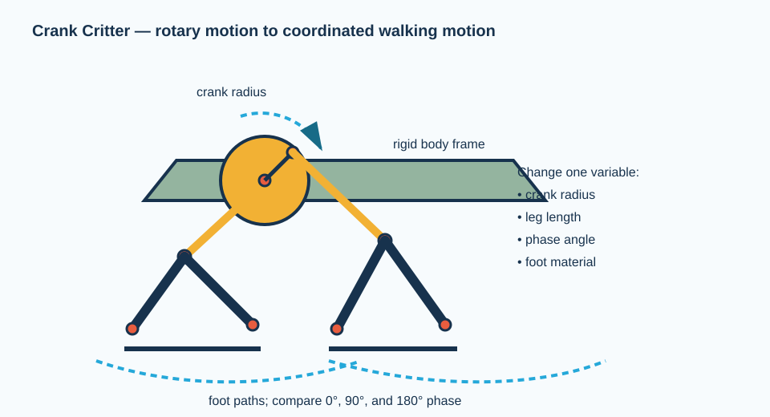

# Crank Critter: walking mechanism and automaton

## Purpose and challenge

Teams make a hand-cranked creature, character, or machine in which a rotating crank drives two or more repeating motions. The performance challenge is to traverse 1 m, create the most repeatable gait, or tell a short mechanical story with at least two coordinated motions.

**Design status:** proposed instructional design; pilot validation is required. This is intentionally a low-load mechanism made from craft materials.

## Engineering model

A crank converts rotary input to oscillating or reciprocating output. The system’s behavior depends on link lengths, pivot locations, crank radius, friction, and phase angle between motions. A mechanism with too many unconstrained pivots may flex or bind; a structure that is too rigid may not have the degrees of freedom required to walk.

## Bill of materials — one critter

| Item | Specification and role | Qty. | Purchase link |
| --- | --- | ---: | --- |
| Frame/link stock | Jumbo craft sticks or 3–6 mm plywood strips | 16–24 | [Amazon: jumbo craft sticks](https://www.amazon.com/s?k=jumbo+craft+sticks) |
| Pivot hardware | Brass paper fasteners or #4/#6 screws with washers and nuts | 20–30 | [Amazon: brass fasteners](https://www.amazon.com/s?k=brass+paper+fasteners+assortment) / [McMaster: screws](https://www.mcmaster.com/products/screws/) |
| Crank axle | Wooden skewer, 3–5 mm dowel, or a selected shaft system | 1 | [Amazon: dowel assortment](https://www.amazon.com/s?k=wood+dowel+assortment) |
| Crank disk | Cardboard circle or small plywood disk with offset pin hole | 1 | [Amazon: cardboard sheets](https://www.amazon.com/s?k=cardboard+sheets+for+crafts) |
| Bearing substitutes | Drinking straws or short tube sections for axle sleeves | 2–4 | locally available |
| Feet | Rubber bands, foam tape, or felt pads to tune traction | 4–8 | [Amazon: adhesive felt pads](https://www.amazon.com/s?k=small+adhesive+felt+pads) |
| Optional spring | Light extension/rubber-band return element | 2–4 | [McMaster: spring assortments](https://www.mcmaster.com/products/spring-kits) |

## Assembly

1. **Sketch one side first.** Draw a body line, a crank center, and front/rear foot contact points on paper. Make the first side functional before duplicating it.
2. **Build a rigid body.** Make a triangular or rectangular craft-stick body approximately 150 mm long. Reinforce joints with a second stick or gusset; flexible frames hide linkage behavior.
3. **Make the crank.** Punch an axle hole at the disk center and a drive-pin hole 15–25 mm away from center. The offset distance is the crank radius and sets approximate stroke.
4. **Build the legs.** Use two or three sticks per leg and pivots at knee/hip locations. Initially give each side only the minimum pivots required for visible motion.
5. **Connect crank to legs.** Join the crank pin to a connecting rod, then to the leg linkage. Adjust one joint at a time until the foot traces a useful path rather than only swinging in the air.
6. **Duplicate and phase the opposite side.** Create the opposite linkage after the first side works. Set its crank 180° out of phase for alternating motion, then test 90° and 0° as comparisons.
7. **Tune traction and stability.** Add felt, rubber-band feet, or a small low-mounted mass. Observe whether slipping, tipping, or linkage binding limits travel.
8. **Document one controlled change.** Change exactly one of: crank radius, leg length, body height, phase angle, or foot material. Measure distance traveled in ten turns of the crank.

## Suggested investigation cards

- How does increasing crank radius change stride length and likelihood of binding?
- Which phase angle makes the mechanism most stable: 0°, 90°, or 180°?
- Does the fastest gait travel the farthest? Explain using slip and stability observations.

## Troubleshooting

| Observation | Likely physical cause | First correction |
| --- | --- | --- |
| Crank jams | Overconstrained linkage or misaligned pivots | Remove one constraint; align pivots; add washer clearance |
| Feet only slide | Low traction or poor foot path | Add felt/rubber; change linkage geometry |
| Body tips | Center of mass too high or support polygon too small | Lower the body; widen stance; add a low mass |
| Motion is tiny | Crank radius or linkage leverage too small | Increase crank offset gradually |
