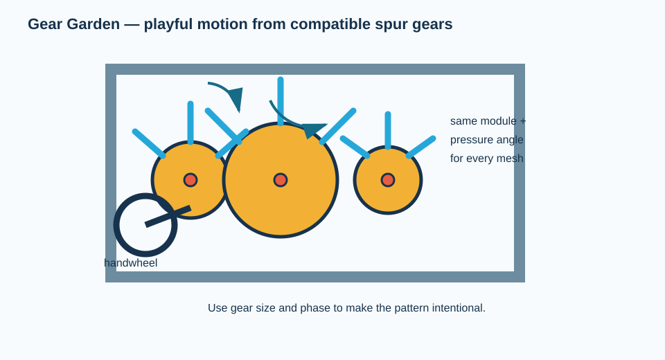
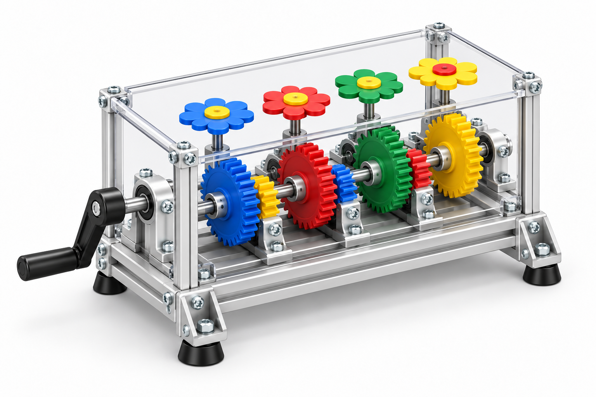

# Gear Garden: hand-cranked kinetic sculpture

*Illustrative 3D concept render, not a dimensioned CAD assembly or a substitute for the exact-item BOM and physical pilot.*

Make a colorful, hand-cranked “garden” in which several plastic gears rotate at different speeds and directions. It is deliberately toy-like, yet every visible element is a conventional machine component.

**Design status:** rendered concept; **not** yet an approved student build. The earlier category-only BOM has been retired. A full exact-item, no-fabrication BOM and physical pilot are required by the [build standard](../../docs/BUILD_STANDARD.md). Decorative parts remain non-load-bearing.

## Exact purchased components captured to date — not a complete BOM

| Function | Exact supplier item | Qty. | Direct item link |
| --- | --- | ---: | --- |
| Fixed-length base member | McMaster `5537T368`, 20 mm T-slotted rail, 12 in. | 2 | [5537T368](https://www.mcmaster.com/5537T368/) |
| Fixed-length cross member | McMaster `5537T2`, 20 mm T-slotted rail, 6 in. | 2 | [5537T2](https://www.mcmaster.com/5537T2/) |
| Driver gear | McMaster `2664N316`, module 0.5, 24-tooth steel spur gear, 5 mm set-screw bore | 1 | [2664N316](https://www.mcmaster.com/2664N316/) |
| Driven gear | McMaster `2664N321`, module 0.5, 36-tooth steel spur gear, 5 mm set-screw bore | 1 | [2664N321](https://www.mcmaster.com/2664N321/) |

**Release blockers:** a fixed-length 5 mm shaft, factory-mountable supports, T-slot brackets/fasteners, a hand crank, pinch guard, and each decorative attachment have not yet been selected at item-number level. The visual’s plastic gears are illustrative; the currently checked gears are steel. Do not substitute raw stock or a cut panel.

## Conceptual assembly sequence — replace with an item-specific graphical manual after the release gate

1. Build a 200–250 mm wide frame with a vertical mounting plate or two rails that hold the gear shafts parallel.
2. Choose one gear family and place shafts so adjacent gears mesh with modest backlash, not forced contact.
3. Fix a handwheel to the input shaft. Add a 20-tooth driver, then choose different driven gear sizes for visibly distinct speeds.
4. Lock each gear to its shaft with a collar or hub. Free-spinning decorations may be mounted with a washer and small clearance.
5. Add colored cable ties or tags only after the drive train runs smoothly; keep them clear of meshes.
6. Have teams create a repeatable pattern: two “flowers” in opposite directions, one slower/larger flower, or a gear that carries a turning flag.
7. Add a clear guard or maintain a finger-safe separation around every mesh before public use.

## Physics prompt

For two meshing external gears, the gears rotate in opposite directions and \(\omega_2/\omega_1=-N_1/N_2\). Compare a 20-tooth driver coupled to 20-, 30-, and 40-tooth gears. The minus sign denotes direction reversal; it is not a negative speed magnitude.

## Success criteria

- All meshing gears share module and pressure angle.
- The sculpture can run for 20 crank turns without a gear climbing or a decoration entering a mesh.
- Teams can predict the relative speed and direction of a selected output before turning the crank.
