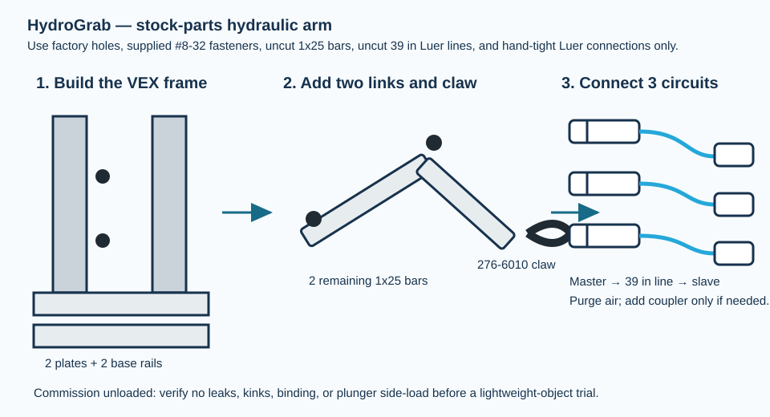
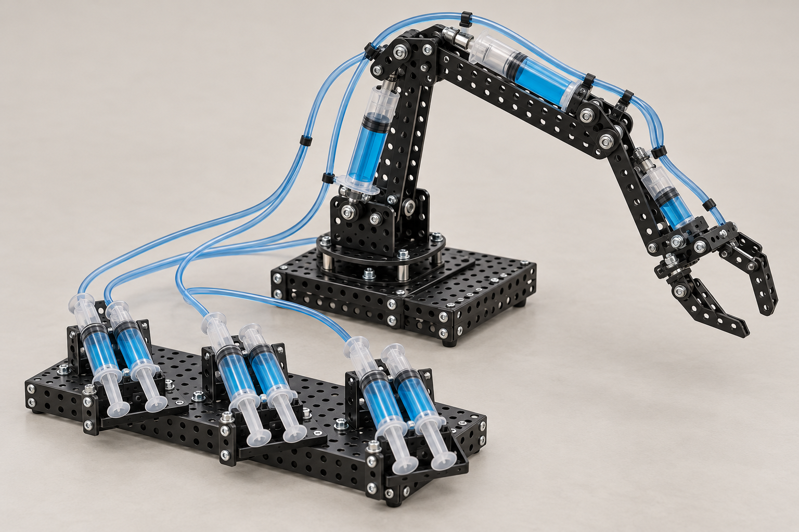

# HydroGrab: water-powered tabletop arm

*Illustrative 3D concept render of the catalog-parts direction: a syringe-and-tube hydraulic arm on factory-perforated structure. The legacy BOM below is retained for audit traceability and does **not** yet specify this no-fabrication rendered configuration.*

## Purpose and challenge

Teams build a two-link arm with a gripper, then transfer a foam block from a pickup zone to a target bin. The scoring task is intentionally low-load: place three blocks accurately, then modify one feature to improve reach, lifting force, or placement repeatability.

**Design status:** proposed instructional design; pilot validation is required. **Intended boundary:** water, needleless syringes, and lightweight objects only.

## Engineering model

For an ideal hydraulic pair, the output force and displacement are related to input force and displacement by

\[
F_\mathrm{out}/F_\mathrm{in} \approx A_\mathrm{out}/A_\mathrm{in}, \qquad
x_\mathrm{out}/x_\mathrm{in} \approx A_\mathrm{in}/A_\mathrm{out}.
\]

The relationships neglect leakage, trapped air, syringe friction, tubing compliance, and linkage geometry. Have teams observe these losses rather than claim ideal performance. For a link carrying a payload, discuss the moment about a pivot: \(M = F r_\perp\).

## Bill of materials — one arm

| Item | Specification and role | Qty. | Purchase link |
| --- | --- | ---: | --- |
| Syringes | Needleless 20–30 mL Luer-slip or Luer-lock syringes; one matched master/slave pair for each of shoulder, elbow, and gripper | 6 | [Amazon: needleless syringe assortment](https://www.amazon.com/s?k=needleless+luer+lock+syringe+20ml) |
| Tubing | Clear flexible tubing compatible with the selected syringe tip; 0.6 m per circuit plus spare | 2.2 m | [Amazon: silicone tubing](https://www.amazon.com/s?k=clear+silicone+tubing+luer+lock+adapter) / [McMaster: tubing](https://www.mcmaster.com/products/tubing/) |
| Luer adapters | Barbed Luer-to-tubing adapters if the tubing does not seal directly on the syringe | 6 | [Amazon: Luer barbed adapters](https://www.amazon.com/s?k=luer+lock+barbed+tubing+adapter) |
| Arm members | Craft sticks, 1/8 in plywood strips, or laser-cut stock; two parallel pieces per main link | 12–16 | [Amazon: craft sticks](https://www.amazon.com/s?k=jumbo+craft+sticks) |
| Base | 20 cm × 20 cm foam board or plywood | 1 | [Amazon: foam board](https://www.amazon.com/s?k=foam+board+sheet) |
| Pivot hardware | #6-32 × 1 in screws, washers, and locknuts; substitute a consistent M3/M4 family | 12 sets | [McMaster: machine screws](https://www.mcmaster.com/products/screws/) |
| Return element | Rubber bands for gripper return and cable ties for strain relief | 4–8 | [Amazon: rubber bands](https://www.amazon.com/s?k=rubber+band+assortment) |
| Payload | Foam cubes, folded paper cups, or empty plastic capsules | 3 | locally available |

### Facilitator tools

Hole punch or predrilled pieces, ruler, screwdriver, marker, tray for water, paper towels, and low-temperature hot glue **used by facilitators only** if reinforcement is needed.

## Assembly

1. **Make the base and shoulder.** Mark a centerline on the base. Build two upright, parallel shoulder plates 25–30 mm apart; install a screw-and-washer pivot through the first arm link. The arm should rotate freely without side-to-side rubbing.
2. **Build the upper and forearm links.** Use paired craft sticks or strips separated by washers. Join them at an elbow pivot. Start with approximately 120 mm upper-arm and 100 mm forearm lengths; record the actual lengths used.
3. **Add the gripper.** Attach two short sticks as jaws around a pivot. Add a rubber band that tends to open the jaws. A syringe linkage closing the jaws against that return force is easier to diagnose than a fully hydraulic two-jaw design.
4. **Mount slave syringes.** Pin or zip-tie each slave barrel to the stationary member and connect its plunger to the member it should rotate. For the shoulder, barrel on base and plunger on upper arm; for elbow, barrel on upper arm and plunger on forearm. Keep each plunger force nearly perpendicular to its driven link near mid-stroke.
5. **Prepare each hydraulic circuit.** Fill one syringe and its tubing completely with water. Connect the matched slave syringe while both are flooded. Cycle slowly with the slave pointed upward until visible air bubbles are minimized; then attach it to the arm. A bubble is a useful lesson in compressibility, but too much air makes control poor.
6. **Mount master syringes.** Tape or clamp the three master syringes to a control board in the same order as shoulder, elbow, and gripper. Label push/pull directions with arrows.
7. **Check motion without payload.** Move one circuit at a time. Correct binding before adding the target objects. If a joint does not return, inspect pivot friction, syringe alignment, trapped air, and tube kinks.
8. **Run the challenge.** Start with three light objects 10–20 cm from the base. Measure placement count, time, or reachable area; change only one variable between trials.

## Suggested investigation cards

- What changes when the slave syringe diameter is increased while the master is held fixed?
- How does moving the shoulder-cylinder attachment closer to its pivot affect required hand force and arm travel?
- Where does the arm first lose accuracy: the hydraulic circuit, a flexible frame, a loose pivot, or the gripper?

## Troubleshooting

| Observation | Likely physical cause | First correction |
| --- | --- | --- |
| Spongy motion | Trapped air or flexible tubing | Refill and purge the circuit; shorten tubing |
| Arm will not lift | Moment demand exceeds actuator/linkage force | Reduce payload, shorten reach, or reposition attachment point |
| Joint sticks | Pivot overtightened or links rubbing | Add washers; loosen locknut just enough for free rotation |
| Water leak | Mismatched tubing or incomplete seal | Stop, dry the area, replace/secure adapter, then refill |
