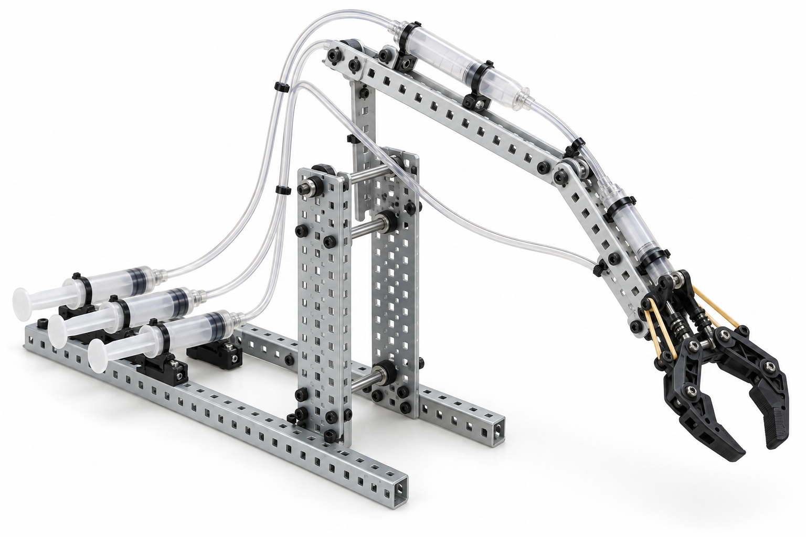

# HydroGrab: water-powered tabletop arm




*Illustrative, BOM-constrained 3D render. It depicts the factory-perforated VEX structure, uncut Luer extension sets, 20 mL syringe pairs, cable-tie retention, and the VEX Claw Kit called out below. It is not evidence of a physical first article.*

## Purpose and challenge

Teams assemble a two-link, syringe-actuated tabletop arm from stock parts only, then use the claw to move a light classroom object. The activity contrasts ideal hydraulic force/displacement relations with loss of accuracy from air, friction, compliance, and linkage angle.

**Design status:** exact-catalog redesign drafted; a water/leak, range-of-motion, and claw-linkage first article is required before classroom release. **Boundary:** water and lightweight dry objects only; no needles, loads, or pressurization beyond hand force.

## Engineering model

For a matched ideal hydraulic pair, \(F_\mathrm{out}/F_\mathrm{in}\approx A_\mathrm{out}/A_\mathrm{in}\) and \(x_\mathrm{out}/x_\mathrm{in}\approx A_\mathrm{in}/A_\mathrm{out}\). These relations neglect leakage, trapped air, syringe friction, tubing compliance, and the changing perpendicular moment arm of the linkage. The pivot moment is \(M=F r_\perp\). Students should measure departure from the ideal model rather than treat it as an expected performance guarantee.

## Bill of materials — one arm

The VEX kit's factory hole pattern, #8-32 screws/nuts/washers, 1x25 bars, steel plates, bearings, collars, and 2/3/12 in square shafts are the structural interface. No part is cut, drilled, milled, or 3D printed. The shared tool kit is listed in the consolidated purchase list.

| Item | Exact purchased configuration and use | Qty. used / purchased | Purchase link |
| --- | --- | ---: | --- |
| Structural kit | VEX Robotics **276-2161 Metal & Hardware Kit**; use the two 5x15 plates, two 1x25 base rails, two 1x25 arm links, supplied #8-32 hardware, bearings, collars, and short shafts | 1 / 1 kit | [VEX 276-2161](https://www.vexrobotics.com/276-2161.html) |
| End effector | VEX Robotics **276-6010 Claw Kit v2**; use its assembled claw, supplied #64 rubber bands, 12T gear, and 4x-pitch shaft as provided | 1 / 1 kit | [VEX 276-6010](https://www.vexrobotics.com/276-6010.html) |
| Syringes | Yalomi **ASIN B0DXMZ7XLW**, 20 mL Luer-lock syringe without needle, 30-pack; select six identical syringes for three matched master/slave pairs | 6 / 30 pack | [Amazon B0DXMZ7XLW](https://www.amazon.com/dp/B0DXMZ7XLW) |
| Fluid lines | **ASIN B0GSVQK5WJ**, 39 in Luer extension set, 10-pack; use three complete, uncut lines | 3 / 10 pack | [Amazon B0GSVQK5WJ](https://www.amazon.com/dp/B0GSVQK5WJ) |
| Luer coupling | **ASIN B01KY6X6CS**, polypropylene female-to-female Luer-lock adapter, 10-pack; use three only where required to join a line end to a syringe | up to 3 / 10 pack | [Amazon B01KY6X6CS](https://www.amazon.com/dp/B01KY6X6CS) |
| Retention and strain relief | VEX Robotics **275-0125**, 11 in zip ties, 100-pack; secure syringe barrels, plunger-link bars, and tube strain relief | up to 18 / 100 pack | [VEX 275-0125](https://www.vexrobotics.com/275-0125.html) |
| Shared hand tools | VEX Robotics **276-1382 Tool Kit**; use the supplied 5/64 in hex key and wrench with the kit hardware | shared / 1 kit | [VEX 276-1382](https://www.vexrobotics.com/276-1382.html) |

**Hydraulic interface check before build.** The selected extension set is listed as a Luer extension set with a Luer connector and capped Luer-lock fitting; the selected female-to-female couplers provide the contingency connection. Verify the actual received male/female ends before filling. Do not proceed if a clean, hand-tight Luer-lock circuit cannot be formed without forcing a connector.

## Graphical assembly path

```text
master syringe ── uncut 39 in Luer line ── slave syringe ── zip-tie linkage ── VEX arm member
        (one complete, purged circuit for shoulder, elbow, and claw)

two 5x15 plates + two 1x25 base rails → shoulder pivot → one 1x25 upper link → elbow pivot
                                                                       ↓
                                                            one 1x25 forearm → Claw Kit v2
```

1. **Build the non-moving base.** Join the two 5x15 plates with two uncut 1x25 bars as base rails and supplied #8-32 hardware so the plates are parallel. Use factory holes only. Tighten nuts against washers; do not overtighten a joint intended to pivot.
2. **Make the two links.** Use one 1x25 bar for the upper link and one for the forearm. Install a supplied square shaft through aligned factory holes with bearings/collars as pivot retainers. Leave a small running clearance and verify each link swings before adding an actuator.
3. **Install the claw.** Fasten the unmodified 276-6010 claw to the forearm through its supplied VEX-compatible mounting holes. Its rubber bands supply the claw return force. Do not add a motor; the third syringe is the proposed manual actuator.
4. **Mount slave syringes.** For shoulder and elbow, zip-tie each *barrel* to the stationary adjacent structure and couple the plunger flange directly to the driven VEX link with a zip-tie loop. For the claw, retain the barrel on the forearm and couple the plunger to the Claw Kit actuator point. Keep the plunger centered through its full stroke; if it side-loads or sticks, stop and revise the attachment holes—do not force it.
5. **Make three closed fluid circuits.** For each pair, connect one complete 39 in extension set between two 20 mL syringes. Use a B01KY6X6CS coupler only when the received extension end requires it. Fill slowly with water, hold the slave upward, and cycle until visible bubbles are minimized. Keep water away from floors/electronics and dry all leaks before continuing.
6. **Place master syringes.** Retain masters against one exterior base rail with zip ties; label shoulder, elbow, and claw. Route each uncut line with gentle bends and a zip-tie strain-relief loop—not through a gear mesh or pivot.
7. **Commission unloaded.** Move one circuit at a time. Confirm no leak, tube kink, joint bind, or syringe-plunger side load. Then use the claw only with a lightweight dry classroom object. Record the relationship between master travel, slave travel, and joint angle.

## First-article acceptance checks

- Every fastener is supplied by 276-2161 and is #8-32; every structural hole used is factory-provided.
- Each water circuit remains sealed under slow hand operation for five cycles; no connector is forced.
- A full syringe stroke does not bottom a structural pivot or side-load a plunger.
- Claw opens/returns without a motor and without a loose part entering a moving linkage.

## Troubleshooting

| Observation | Likely physical cause | First correction |
| --- | --- | --- |
| Spongy motion | Trapped air or line compliance | Refill/purge one circuit and use the complete line without a kink |
| Arm will not lift | Linkage moment demand exceeds available syringe force | Test unloaded; shorten the effective lever arm using another existing VEX hole |
| Joint sticks | Pivot hardware clamped too tightly or bars rub | Restore washer/bearing clearance and retighten only fixed members |
| Water leak | Received Luer ends are incompatible or not hand-tight | Stop, dry, verify connector gender, then add the listed female-to-female coupler if needed |
