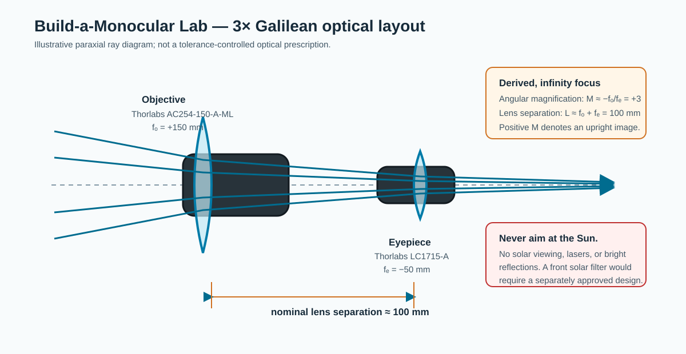
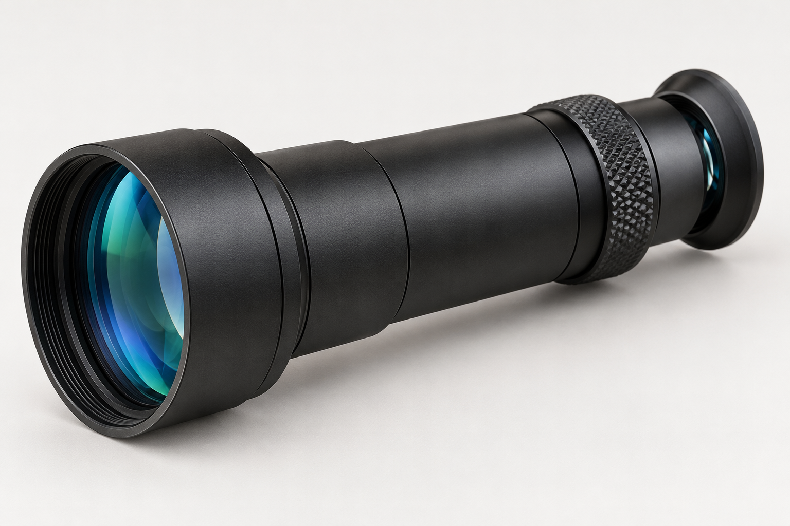
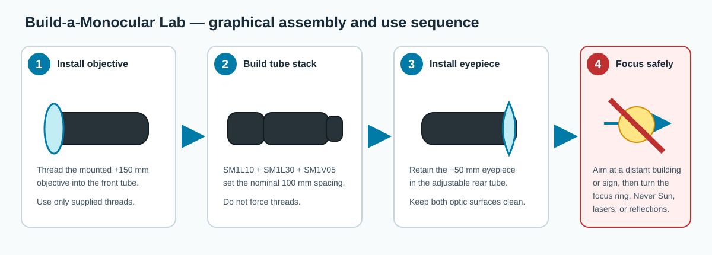

# Build-a-Monocular Lab: threaded 3× Galilean telescope

*Illustrative 3D concept render, not geometry-certified CAD or a tolerance-controlled optical prescription. The purchasable baseline is the exact threaded-component stack below.*

Students assemble an upright, fixed-aperture Galilean monocular from catalog lenses and SM1-threaded lens tubes. It is intentionally a terrestrial-viewing optics activity: the outcome is a real instrument plus a direct investigation of focal length, angular magnification, focus, and optical alignment—without cutting, drilling, soldering, or machining.

**Status:** procurement-complete rendered concept; **not yet classroom-release ready.** The BOM specifies every component of the illustrated optical stack, but a physical first article must verify infinity focus, lens retention, image quality, and adult-facilitated safe use before release. See the [no-fabrication build standard](../../docs/BUILD_STANDARD.md).

## Optical design basis

| Quantity | Value | Status and interpretation |
| --- | ---: | --- |
| Objective focal length, \(f_o\) | +150 mm | Manufacturer specification for `AC254-150-A-ML` |
| Eyepiece focal length, \(f_e\) | −50 mm | Manufacturer specification for `LC1715-A` |
| Nominal angular magnification, \(M=-f_o/f_e\) | +3× | Derived paraxial value; positive sign denotes an upright image |
| Nominal lens separation, \(L\approx f_o+f_e\) | 100 mm | Derived for distant objects; it is a principal-plane target, **not** a tube-length drawing |
| Fine focus adjustment | 0.50 in / 12.7 mm | Manufacturer specification for `SM1V05`; used to tune the actual first article |

The derivation assumes a distant terrestrial target, paraxial rays, nominal focal lengths, and no accommodation or prescription correction by the observer. Real lens principal-plane locations, retaining-ring seats, and eye position shift the best setting; the focus tube is therefore adjusted empirically during the first article rather than set by measurement alone.

## Complete bill of materials — one monocular

| Function | Exact item and purchased configuration | Buy | Use | Direct item link |
| --- | --- | ---: | ---: | --- |
| Objective | Thorlabs `AC254-150-A-ML`, Ø1 in mounted achromatic doublet, \(f=150\) mm, 400–700 nm AR coating, SM1-threaded mount | 1 | 1 | [AC254-150-A-ML](https://www.thorlabs.com/item/AC254-150-A-ML) |
| Negative eyepiece | Thorlabs `LC1715-A`, Ø1 in N-BK7 plano-concave lens, \(f=-50\) mm, 350–700 nm AR coating | 1 | 1 | [LC1715-A](https://www.thorlabs.com/thorproduct.cfm?partnumber=LC1715-A) |
| Front spacer tube | Thorlabs `SM1L10`, SM1 lens tube, 1.0 in nominal thread depth, including one retaining ring | 1 | 1 | [SM1L10](https://www.thorlabs.com/item/SM1L10) |
| Main spacer tube | Thorlabs `SM1L20`, SM1 lens tube, 2.0 in nominal thread depth, including one retaining ring | 1 | 1 | [SM1L20](https://www.thorlabs.com/item/SM1L20) |
| Fine-focus / eyepiece cell | Thorlabs `SM1V05`, Ø1 in SM1 rotating adjustable-length lens tube, 0.50 in travel, including one retaining ring and locking ring | 1 | 1 | [SM1V05](https://www.thorlabs.com/thorproduct.cfm?partnumber=SM1V05) |

No raw stock, adhesive, fastener, tool, cut spacer, or fabricated lens cell is needed. The `AC254-150-A-ML` is supplied mounted. The nominal lengths of `SM1L10`, `SM1L20`, and `SM1V05` sum to 3.5 in. (88.9 mm) before the lens mounting depths and principal-plane offsets; this deliberately leaves the focus tube to tune the actual system around the 100 mm optical target. The retaining ring supplied with `SM1V05` secures the unmounted `LC1715-A`; do not substitute a loose lens holder or a generic tube without verifying SM1 compatibility. Thorlabs is the specified baseline because all mechanical interfaces are named. B&H Photo Video and MKS/Newport are acceptable sources for a future, separately validated optical alternative, but their components are **not** interchangeable by assumption.

## Item-specific assembly sequence

1. Work on a clean, dry table. Confirm that the `AC254-150-A-ML`, `LC1715-A`, `SM1L10`, `SM1L20`, and `SM1V05` are free of chips, cracks, and damaged threads. Handle lenses only by their edges.
2. Thread the mounted `AC254-150-A-ML` objective onto the front of `SM1L10` by hand. Join `SM1L10` to `SM1L20`, then join `SM1L20` to the non-rotating end of `SM1V05`. Thread parts together only until seated; do not force or cross-thread them.
3. Seat the `LC1715-A` in the rear `SM1V05` cell with its concave surface facing the objective as the starting configuration. Install the retaining ring supplied with `SM1V05` finger-tight, only enough to stop the lens from rattling. Do not use pliers or a sharp tool on the glass.
4. Point the instrument only at a distant terrestrial target such as a building, tree line, or sign—never at the Sun, a laser, or a bright specular reflection. Look through the eyepiece while slowly rotating the `SM1V05` focus section to find the sharpest image, then finger-tighten its locking ring.
5. Check that the eyepiece cannot move when the monocular is gently tipped. If the image cannot be focused, stop and have the facilitator inspect thread engagement, lens seating, and the first-article optical orientation; do not add a cut spacer or force the focus tube.

## First-article checks before release

- Use a distant terrestrial target to verify that a sharp setting exists within the `SM1V05` adjustment range and that the locking ring preserves it through handling.
- With the objective capped or pointed at an evenly lit wall, gently tip and rotate the instrument. Verify that neither lens rattles or shifts, and inspect the glass for chips, coating damage, fingerprints, or a loose retaining ring.
- Compare the apparent spacing of two distant vertical features with and without the monocular. The derived target is about 3×; record the measurement method, target distance, observed value, and observer limitations rather than reporting the paraxial value as measured performance.
- Have an adult facilitator inspect each instrument before students use it. Remove any assembly with damaged optics, a loose lens, cross-threaded tubes, or a focus lock that slips.

## Physics prompt

For a Galilean monocular, the negative eyepiece intercepts the converging beam from the positive objective. Students can predict \(M=-f_o/f_e\), explain why the image is upright when the ratio is positive, then compare that prediction to an angular-scale observation on a distant terrestrial target. Ask: what changes if the negative eyepiece focal length has a smaller magnitude, and why does the focus setting depend on both the target distance and the observer’s eye?

## Safety boundary

This project is for supervised terrestrial viewing only. **Never point it at the Sun, even with eclipse glasses at the eye.** NASA states that viewing the bright Sun through binoculars, a telescope, or another optical device without a special-purpose front filter can cause immediate severe eye injury; this design includes no solar filter and is not a solar instrument. Do not view lasers, welding arcs, or bright reflected light. See [NASA’s optical-device solar-safety guidance](https://science.nasa.gov/eclipses/safety/) and the repository [safety requirements](../../docs/SAFETY.md).
