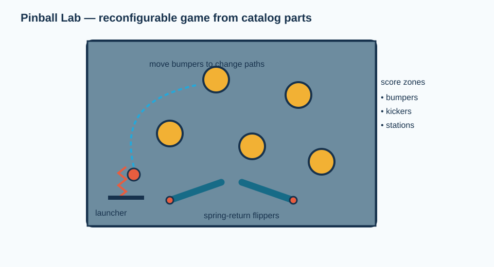
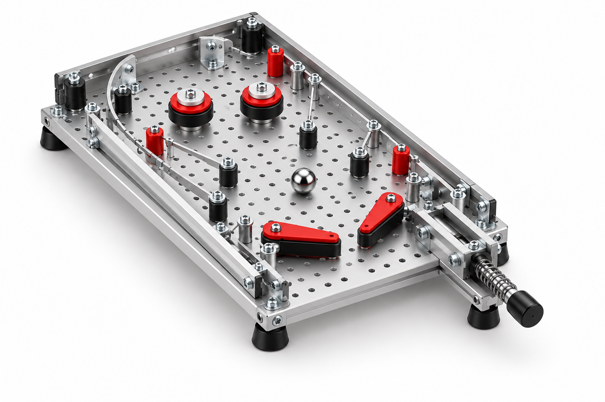
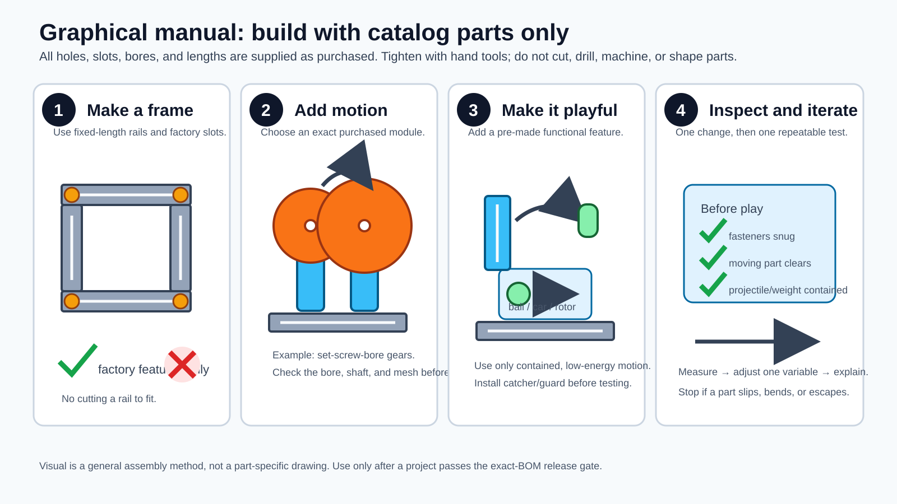

# Pinball Lab: reconfigurable tabletop game

*Illustrative 3D concept render. The no-cut build below deliberately uses a narrower, lower-fidelity VEX plate playfield and hard/rubber post bumpers; it is not a dimensioned CAD assembly.*

This is a compact, hand-powered pinball game. Students vary bumper locations, flipper angle, or launcher preload and compare ball paths and game duration.

**Status:** procurement-complete rendered concept; **not yet classroom-release ready.** The exact items below are sufficient to buy the proposed no-fabrication version, but the first article must verify fit, ball containment, flipper travel, and the plunger/hinge-to-hole alignment before student use. See the [build standard](../../docs/BUILD_STANDARD.md).

## What the purchasable version changes

| Rendered feature | No-fabrication implementation |
| --- | --- |
| Wide custom-looking playfield | Two factory-perforated VEX 5 x 25 aluminum plates, side-by-side (about 5 x 12.5 in.) |
| Molded bumper cups | Four 1/8-in. VEX shafts retained in factory holes, with slide-on rubber collars; adhesive bumpers provide additional targets |
| Shaped flippers | Two factory-hole spring hinges with straight steel mending-plate paddles |
| Long custom rails | Two full-length VEX C-channels and two VEX 5 x 15 steel end plates |

## Complete bill of materials — one tabletop game

`Buy` means packages to order. `Use` is the portion of the package consumed by one game; the remainder is spare inventory, not an unspecified component.

| Function | Exact item and purchased configuration | Buy | Use | Direct item link |
| --- | --- | ---: | ---: | --- |
| Perforated playfield | VEX V5 `276-2311`, 5 x 25 Aluminum Plate | 1 pack | 2 plates | [276-2311](https://www.vexrobotics.com/276-2311.html) |
| Frame, post shafts, factory-hole end barriers, bearings, standoffs, #8-32 screws/nuts/washers | VEX V5 `276-2161`, Metal & Hardware Kit | 1 kit | 2 5x15 plates; 4 2-in. shafts; 4 lock plates; hardware as supplied | [276-2161](https://www.vexrobotics.com/276-2161.html) |
| Long raised side rails | VEX V5 `276-2288`, 1x2x1x25 Aluminum C-Channel | 1 pack | 2 full-length channels | [276-2288](https://www.vexrobotics.com/276-2288.html) |
| Cushioned post sleeves | VEX `228-3510`, Rubber Shaft Collar (30-pack), for 0.125-in. VEX shafts | 1 pack | 8 collars (two per post) | [228-3510](https://www.vexrobotics.com/228-3510.html) |
| Play ball | McMaster-Carr `9613K21`, 3/8-in. off-white nylon balls (100-pack) | 1 pack | 1 ball | [9613K21](https://www.mcmaster.com/9613K21/) |
| Manual launcher | McMaster-Carr `8478A1`, nonlocking plate-mount retractable spring plunger | 1 | 1 | [8478A1](https://www.mcmaster.com/8478A1/) |
| Two finger flipper pivots | McMaster-Carr `15205A115`, zinc-plated spring hinge, 1-3/4-in. leaves | 2 | 2 | [15205A115](https://www.mcmaster.com/15205A115/) |
| Straight flipper paddles and plunger adapter plates | McMaster-Carr `1555A2`, zinc-plated steel flat bracket, 3 in. long, five #8 holes | 4 | 4 (2 paddles, 2 launcher adapters) | [1555A2](https://www.mcmaster.com/1555A2/) |
| Low-profile target/cushion pads | 3M `SJ5012BL`, Bumpon self-adhesive bumper mini-pack | 1 mini-pack | 8 pads | [SJ5012BL](https://www.3m.com/3M/en_US/p/d/v000057350/) |
| Shared assembly tools | VEX V5 `276-1382`, Tool Kit | 1 shared kit | 1 wrench and 2 hex keys | [276-1382](https://www.vexrobotics.com/276-1382.html) |

No additional fasteners, raw stock, cut panel, or adhesive other than the supplied bumper adhesive is required by this BOM.

## Item-specific assembly sequence

1. Bolt two `276-2311` plates side-by-side with the `276-2161` #8-32 hardware and two supplied standoffs below their seam. Lay the factory hole rows parallel; do not alter the plates.
2. Attach one full `276-2288` C-channel to each long edge. Bolt one 5x15 VEX steel plate across the upper end and one across the lower end, leaving a controlled ball-return opening beside the lower plate.
3. Pass four supplied 2-in. VEX shafts through selected square holes in the playfield. Capture each from below with a supplied lock plate. Slide two `228-3510` collars onto each exposed shaft as a soft, fixed post bumper.
4. Bolt each `15205A115` spring hinge to the plate through its existing holes. Bolt one `1555A2` mending plate to the moving leaf to make each flipper paddle. Confirm that both paddles return under hinge spring force without crossing the ball path.
5. Use the remaining two `1555A2` brackets as a two-plate adapter for `8478A1`; bolt only through existing holes. Install the plunger so its nose points up the playfield and cannot eject the ball over the rail.
6. Press `SJ5012BL` pads onto selected flat plate locations as low-impact targets. Put one nylon ball in the launcher lane. Cycle each moving part by hand before playing.

## First-article checks before release

- Confirm the hinge and plunger factory-hole patterns can be joined with the listed #8 hardware without drilling or enlarging holes.
- Launch 20 balls at the intended maximum hand force. The ball must remain within the perimeter and return through the lower opening.
- Check that fingers cannot enter the hinge/paddle pinch regions while another student launches a ball.

## Physics prompt

The ball’s kinetic energy changes through impacts, rolling resistance, sliding friction, and spring work. A bumper redirects the ball; it does not create energy. Compare bumper-contact count and play time before and after moving one post or pad.
