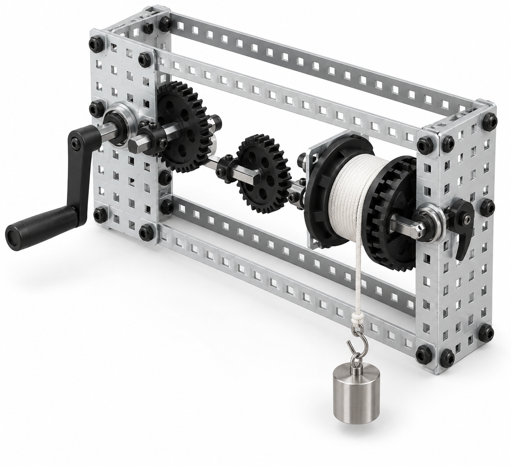

# Rescue Hoist: hand-cranked 9:1 gear winch




*Illustrative, BOM-constrained 3D render of the stock VEX frame, hand crank, two 12T/36T gear stages, ratcheted winch, and factory-supplied rope listed below. It is not physical proof of load capacity, finger clearance, or gear alignment.*

## Purpose and challenge

Teams build a hand-cranked winch with two stock gear stages and a stock ratcheted drum. They first verify the unloaded kinematics, then lift the included 100 g hanging test weight through 20 cm while a spotter maintains the exclusion zone. The investigation compares input turns and perceived effort with direct drive.

**Design status:** exact-catalog redesign drafted; a first article must check gear alignment, rope tracking, ratchet behavior, and guarding before classroom use. **Boundary:** hand operation only; 100 g test weight only; no lifting over a person, no free-drop testing, and no bypassing the ratchet.

## Engineering model

Each 12T-to-36T stage has \(\omega_\mathrm{out}/\omega_\mathrm{in}=12/36=1/3\). Two stages in series give an ideal **9:1 input-turn-to-drum-turn reduction** and nominal 9× torque multiplication before losses. The drum torque requirement is \(T_\mathrm{drum}=W r\). Gear friction, bearing friction, rope layering, ratchet losses, and misalignment are real effects to measure; the design does not assert a load rating.

## Bill of materials — one hoist

| Item | Exact purchased configuration and use | Qty. used / purchased | Purchase link |
| --- | --- | ---: | --- |
| Frame, shafts, bearings, collars, and fasteners | VEX Robotics **276-2161 Metal & Hardware Kit**; use two 5x15 plates, 1x25 base/guard bars, three short square shafts, bearings, collars, and supplied #8-32 hardware | 1 / 1 kit | [VEX 276-2161](https://www.vexrobotics.com/276-2161.html) |
| Gear train | VEX Robotics **276-2169 Gear Kit**; use two 12T and two 36T 24-DP, 20° gears on the VEX 1/8 in square shaft system | 4 / 1 kit | [VEX 276-2169](https://www.vexrobotics.com/gears.html) |
| Crank | VEX Robotics **276-2045 Advanced Mechanics and Motion Kit**; use its second stock hand crank. The one consolidated kit is shared with Crank Critter, which uses the other hand crank plus the cams/followers. | 1 / 1 shared kit | [VEX 276-2045](https://www.vexrobotics.com/276-2045.html) |
| Drum, ratchet, pulleys, and rope | VEX Robotics **276-1546 Winch & Pulley Kit**; use one winch bracket/drum/ratchet/pawl and its factory 4 ft nylon rope, uncut | 1 / 1 kit | [VEX 276-1546](https://www.vexrobotics.com/276-1546.html) |
| Test load | McMaster-Carr **1914T65** 100 g legal-for-trade hanging test weight with top/bottom hooks | 1 / 1 each | [McMaster 1914T65](https://www.mcmaster.com/1914T65/) |
| Shared hand tools | VEX Robotics **276-1382 Tool Kit**; use the supplied hex key/wrench with the kit hardware | shared / 1 kit | [VEX 276-1382](https://www.vexrobotics.com/276-1382.html) |

All holes used are factory-provided. The rope is tied and threaded in its supplied length; it is not cut. The two plate sidewalls and exterior 1x25 bars are an initial gear-access barrier, not a substitute for the physical finger-clearance check below.

## Graphical assembly path

```text
hand crank ─ 12T  ⇄  36T + 12T (same intermediate shaft)  ⇄  36T ─ ratcheted winch drum ─ rope ─ 100 g hooked weight
                   stage 1: 3:1                           stage 2: 3:1        total: 9:1

5x15 side plate | gears/bearings/shafts | 5x15 side plate, with 1x25 base and external guard bars
```

1. **Build the sidewall frame.** Use two 5x15 plates as parallel sidewalls and uncut 1x25 bars as base crossmembers. Bolt only through factory holes with the supplied #8-32 fasteners. Confirm plates are parallel before inserting shafts.
2. **Install the input.** Support the input shaft in two supplied bearings, retain it with collars, mount the 276-2045 hand crank outside a sidewall, and place one 12T gear inside the sidewalls.
3. **Install the compound intermediate shaft.** Support the second shaft in bearings. Secure one 36T gear and one 12T gear on that same shaft with collars so they rotate together. Mesh the input 12T with the intermediate 36T.
4. **Install output and winch.** Support the output shaft in bearings, mount the second 36T gear, and mesh it with the intermediate 12T. Attach the unmodified 276-1546 winch drum/ratchet assembly to the output shaft as its supplied holes and hardware permit. Verify the pawl engages before threading rope.
5. **Route the uncut rope.** Tie one end to the stock drum using the kit's provided attachment feature, take at least three neat turns, and tie the free end to the top hook of 1914T65. Keep the line outside all gears and never wind it around a hand.
6. **Add the access barrier.** Attach 1x25 bars outside the sidewalls over the gear-mesh region using existing holes, leaving the crank and rope path unobstructed. A supervisor must confirm that a student cannot reach the meshes during normal cranking before any load test.
7. **Commission.** First rotate ten input turns with no load; observe that the output advances about one turn. Then lift only the 100 g hanging weight 20 cm above a clear, padded landing surface while a spotter controls the exclusion zone. Stop if a rope piles, a gear climbs, the ratchet slips, or a plate flexes.

## First-article acceptance checks

- Two 12T and two 36T gears are selected from the single 276-2169 kit; the stages are 3:1 × 3:1 = 9:1, not the former 4:1 claim.
- Shafts, bearings, collars, and #8-32 fasteners are from 276-2161; every used shaft fits the VEX square-bore gears.
- The 276-1546 ratchet holds the 1914T65 100 g test weight at rest, and rope never enters a gear mesh.
- A supervisor verifies the gear-access barrier, landing zone, and no-load/100 g sequence before student operation.

## Troubleshooting

| Observation | Likely physical cause | First correction |
| --- | --- | --- |
| Teeth climb or skip | Shaft center/parallelism is wrong or mesh is forced | Stop; move to compatible existing holes and realign sidewalls |
| Handle is hard to turn | Rope rubs, collars are overtight, or a stage binds | Test unloaded; center rope and restore running clearance |
| Rope piles on one side | Drum/rope approach is misaligned | Reposition the rope guide through an existing hole and rewind by hand |
| Load descends | Ratchet/pawl is not seated or rope tie is wrong | Lower to landing surface, inspect, and do not resume until pawl engagement is verified |
