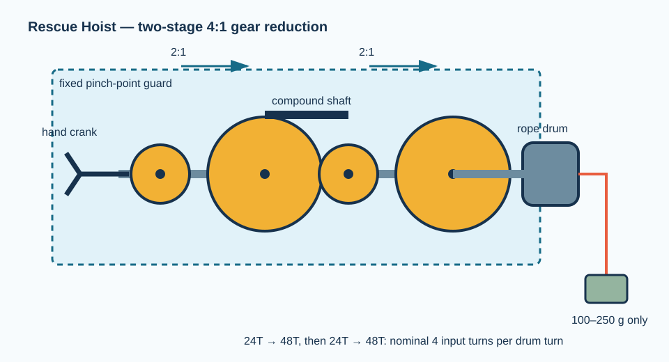

# Rescue Hoist: hand-cranked gear winch

## Purpose and challenge

Teams build a guarded, hand-cranked winch with a two-stage 4:1 gear reduction, then lift a 100–250 g payload through 20 cm. They compare handle turns, lifting time, and perceived effort with a direct-drive configuration.

**Design status:** proposed instructional design; pilot validation is required. Do not exceed the limits in [Safety requirements](../../docs/SAFETY.md).

## Engineering model

For each ideal gear pair, \(\omega_\mathrm{out}/\omega_\mathrm{in}=N_\mathrm{in}/N_\mathrm{out}\). Two 24-tooth-to-48-tooth stages produce approximately \(2 \times 2 = 4\) input turns per output turn, with nominal torque multiplication of 4 before losses. The drum torque requirement is \(T_\mathrm{drum}=W r\), where \(W\) is the payload weight and \(r\) is drum radius.

The real apparatus includes gear, bearing, rope, and alignment losses. Ask students to measure rather than assume the ideal relation.

## Bill of materials — one hoist

| Item | Specification and role | Qty. | Purchase link |
| --- | --- | ---: | --- |
| Spur gears | Four 24-tooth and two 48-tooth spur gears. **All must share 24 DP and 20° pressure angle**, with bores matching the selected shaft system. | 6 | [McMaster: gears](https://www.mcmaster.com/products/gears/) |
| Shafts | 1/4 in diameter steel shaft, cut into three 120–150 mm shafts; use a fully metric system only if all bores match. | 3 | [McMaster: rotary shafts](https://www.mcmaster.com/products/shafts/) |
| Bushings | Low-friction bushings or bearings matched to the shaft diameter | 6 | [McMaster: bearings and bushings](https://www.mcmaster.com/products/bearings/) |
| Shaft collars | Set-screw or clamp collars matched to shaft diameter | 10–12 | [McMaster: shaft collars](https://www.mcmaster.com/products/shaft-collars/) |
| Drum | 25–35 mm diameter spool or 3D-printed drum, 25–40 mm wide | 1 | [Amazon: empty cable spool](https://www.amazon.com/s?k=small+plastic+cable+spool) |
| Rope | Braided nylon/polyester cord, 1–2 mm diameter | 1 m | [McMaster: rope](https://www.mcmaster.com/products/rope/) |
| Frame | Two 1/4 in plywood side plates, about 200 mm × 140 mm, plus base | 1 set | [Amazon: craft plywood](https://www.amazon.com/s?k=1%2F4+inch+craft+plywood+sheets) |
| Handle | Short dowel, screw, washers, and a spacer | 1 | [Amazon: wood dowels](https://www.amazon.com/s?k=wood+dowel+assortment) |
| Payload | 100–250 g soft bag or sealed container of washers | 1 | locally available |
| Guard material | Clear sheet, cardboard, or a fixed mesh guard over meshing gears | 1 | [McMaster: clear polycarbonate](https://www.mcmaster.com/products/polycarbonate-sheets/) |

### Gear-selection note

The gear compatibility and ratio requirements are non-negotiable: a gear’s pitch and pressure angle define the teeth that fit together. See McMaster’s [gear guide](https://www.mcmaster.com/info/how-to-choose-a-gear.html) before ordering. Record actual supplier part numbers in the event purchase log.

## Assembly

1. **Prepare the frame.** On each side plate, mark three parallel shaft centers. Use a trial layout so the 24-tooth and 48-tooth pitch circles meet without forcing the gears together. Drill matched bushing holes and mount the bushings square to the plates.
2. **Install input shaft.** Fit a 24-tooth input gear between the side plates. Add shaft collars outside the bushings to limit axial motion, leaving a small running clearance. Attach the handle to the external end.
3. **Install compound intermediate shaft.** Rigidly secure one 48-tooth gear and one 24-tooth gear on the same shaft. They must rotate together. Verify the 24-tooth input drives the 48-tooth intermediate gear without tooth interference.
4. **Install output shaft and drum.** Mount the second 48-tooth gear on the output shaft so it meshes with the intermediate 24-tooth gear. Center the rope drum on the same shaft and retain it with collars.
5. **Add rope and payload attachment.** Tie the rope to the drum through a small hole or slot, wind three neat turns, and add a closed-loop payload attachment. Keep the rope tracking away from side plates and gears.
6. **Add a fixed guard.** Cover both gear meshes so hands cannot enter while cranking. The handle must remain accessible without reaching through the guard.
7. **Test without load, then at 100 g.** Rotate slowly by hand. Listen for skipping or rubbing. Add the soft catcher under the payload and test at 100 g before using up to 250 g.
8. **Measure and iterate.** Count input turns for a 20 cm lift, compare against direct drive, and document the observed reduction in speed and change in required crank force.

## Suggested investigation cards

- Does the measured input-turn ratio match 4:1? If not, identify rope winding, slip, or gearing explanations.
- How does a larger drum radius change required crank torque and lift distance per output turn?
- How does shaft misalignment change noise, friction, and gear wear risk?

## Troubleshooting

| Observation | Likely physical cause | First correction |
| --- | --- | --- |
| Teeth climb or skip | Incorrect center distance, mismatch, or shaft misalignment | Confirm DP/pressure angle; realign bushings and frame |
| Handle is hard to turn | Rope rub, overtight collars, or excessive payload | Correct rubbing; add clearance; lower payload |
| Rope piles on one side | Drum is not centered or rope approach is angled | Center drum and add a simple fairlead |
| Shaft slides sideways | Missing or loose collars | Add/reposition collars with a small running clearance |
