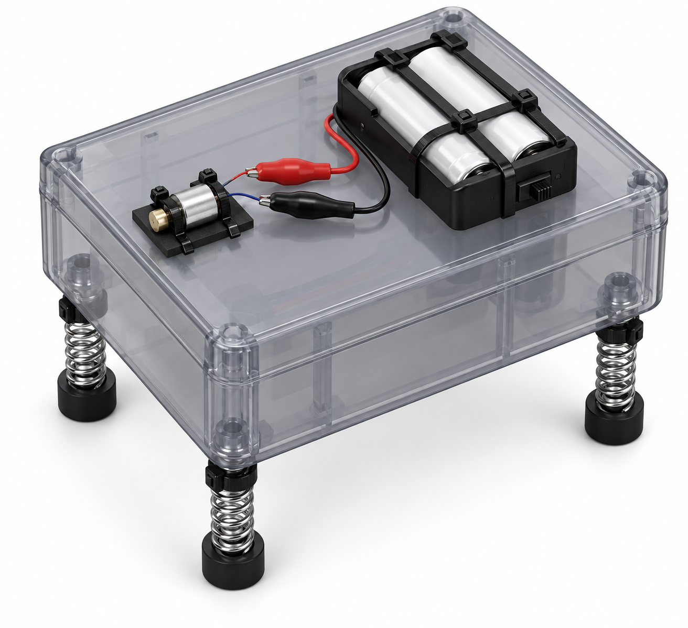

# Springy Wobblebot: vibrating creature

*BOM-constrained 3D render: a stock enclosure, exactly two AA cells in a switched holder, a miniature ERM actuator, two insulated clip leads, four cable-tie-retained springs, and four adhesive bumper feet. It is an illustrative spatial assembly view—not evidence of vendor-to-vendor fit or vibration retention.*

This battery-powered toy demonstrates how an eccentric rotating mass, compliant legs, and ground friction turn vibration into unpredictable motion.

**Status:** procurement-complete rendered concept; **not yet classroom-release ready.** The BOM contains the electronics, enclosure, legs, feet, attachment materials, and batteries required for the proposed 3 V version. A facilitator must complete an electrical and mechanical first article before students use it. See the [build standard](../../docs/BUILD_STANDARD.md).

## What the purchasable version changes

| Rendered feature | No-fabrication implementation |
| --- | --- |
| Sculpted toy body | McMaster factory-molded impact-resistant polycarbonate enclosure |
| Internal custom motor mount | An exact low-current 3 V vibration motor with wire leads, retained to the enclosure with full cable ties |
| Custom spring feet | Four same-size springs selected from a single identified catalog spring kit; 3M self-adhesive polyurethane bumpers as feet |
| Soldered battery wiring | A switched 2xAA holder and two insulated alligator test leads; no stripping, crimping, or soldering |

## Complete bill of materials — one Wobblebot

| Function | Exact item and purchased configuration | Buy | Use | Direct item link |
| --- | --- | ---: | ---: | --- |
| Body | McMaster-Carr `5257N111`, gray impact-resistant polycarbonate enclosure, 3.75 x 4.5 x 2.25 in. | 1 | 1 | [5257N111](https://www.mcmaster.com/5257N111/) |
| Eccentric-mass actuator | Vybronics `VZ4TL2B0370055L`, 3 V low-current ERM vibration motor with wire leads; supplier series specifies 2.2–3.6 V operation | 1 | 1 | [DigiKey 1670-VZ4TL2B0370055L-ND](https://www.digikey.com/en/products/detail/vybronics-inc/VZ4TL2B0370055L/15220806) |
| Switched, solder-free power source | Keystone Electronics `2490SW`, covered 2xAA holder with on/off switch and 6 in. wire leads | 1 | 1 | [DigiKey 36-2490SW-ND](https://www.digikey.com/en/products/detail/keystone-electronics/2490SW/12751690) |
| Insulated removable connections | Adafruit `4100`, 18 in. alligator-to-alligator test-lead set, six leads | 1 set | 2 leads | [DigiKey 1528-2853-ND](https://www.digikey.com/en/products/detail/adafruit-industries-llc/4100/9919540) |
| Battery cells | Panasonic eneloop `BK-3MCCA4BA`, AA NiMH rechargeable batteries, 4-pack, 1.2 V/cell | 1 pack | 2 cells | [Amazon ASIN B00JHKSN76](https://www.amazon.com/dp/B00JHKSN76) |
| Shared charger for repeat sessions | Panasonic eneloop `BQ-CC55SBA`, individual-cell AA/AAA NiMH charger | 1 shared charger | 1 charger | [Amazon ASIN B01G4T230U](https://www.amazon.com/dp/B01G4T230U) |
| Four compliant legs | McMaster-Carr `9618K14`, 126-piece compression-spring assortment | 1 kit | 4 matching 1–1.75-in. compression springs from one compartment | [9618K14](https://www.mcmaster.com/9618K14/) |
| Four non-skid feet and motor cushioning | 3M `SJ5012BL`, Bumpon self-adhesive bumper mini-pack | 1 mini-pack | 4 feet + 2 motor cushions | [SJ5012BL](https://www.3m.com/3M/en_US/p/d/v000057350/) |
| Motor, legs, battery holder, and decoration retention | VEX V5 `275-0125`, 11-in. zip ties (100-pack) | 1 pack | 12 full ties | [275-0125](https://www.vexrobotics.com/275-0125.html) |

The motor and supply are now an electrically compatible, directly orderable set: two eneloop cells provide 2.4 V nominal, within the manufacturer-stated 2.2–3.6 V operating range of the selected motor series. Use one red/black pair from the `4100` lead set to clamp the holder’s factory-tinned leads to the motor’s wire leads. This is a first-article connection, not a claim that clip retention has been validated during vibration.

## Item-specific assembly sequence

1. Keep the `2490SW` switch **off**. Install two charged `BK-3MCCA4BA` cells in the holder, but do not connect the test leads yet. The two-cell nominal supply is 2.4 V and must be recharged only with the shared `BQ-CC55SBA` NiMH charger.
2. Select four springs of the same size from one `9618K14` compartment. Use paired `275-0125` cable ties around the enclosure body and the top coil of each spring to retain four legs. Leave each tie full length; do not trim it.
3. Press one `SJ5012BL` bumper onto the lower end of each spring. Allow the adhesive to set according to the bumper supplier’s handling guidance before a motion test.
4. Place two `SJ5012BL` bumpers on the enclosure top as cushions. Lay `VZ4TL2B0370055L` across them and use two full `275-0125` cable ties around the enclosure to prevent motor rotation or translation. Ensure its eccentric mass can rotate without touching any tie, wall, or hand.
5. Retain the battery holder against one enclosure side with two additional full cable ties. Use one red/black pair from `4100`: clamp the red lead between the positive holder lead and one motor wire, and the black lead between the negative holder lead and the other motor wire. The exposed clips must not touch each other or any conductive part.
6. Place the bot on a clear, smooth floor or tray. Turn the switch on for a 5 s supervised trial, then off before changing legs, feet, or cable-tie position.

## First-article checks before release

- Use only the specified two-cell `BK-3MCCA4BA` NiMH arrangement (2.4 V nominal), which lies within the supplier-stated 2.2–3.6 V operating range of the selected vibration-motor series. This design excludes USB supplies, wall supplies, alkaline cells, and battery types other than the specified 2xAA NiMH arrangement.
- With power off, rotate the eccentric mass by hand; it must clear the enclosure, ties, clips, springs, and student-accessible edges.
- Run five 10 s trials on a floor tray. Inspect cable-tie retention, bumper adhesion, clip grip, wire insulation, and enclosure temperature after each trial. Remove the build from use if a clip loosens, a wire is damaged, or the motor is hot to touch.

## Physics prompt

The rotating offset mass creates a periodic force with magnitude that scales approximately as \(F\approx m e \omega^2\), where \(m\) is eccentric mass, \(e\) is offset, and \(\omega\) is angular speed. Motion across the floor depends on friction and how vibration couples to the spring legs; it need not increase monotonically with offset.
