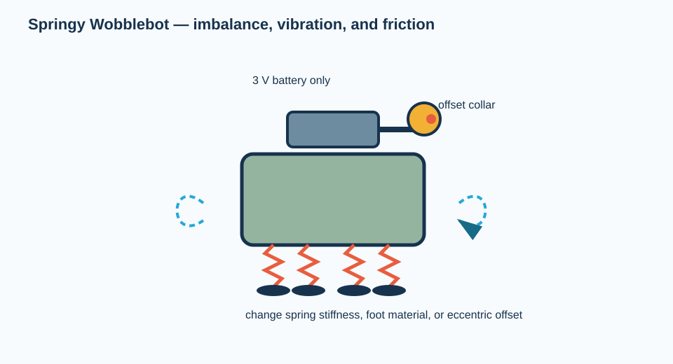

# Springy Wobblebot: vibrating creature

Build a small, expressive creature that travels by vibrating an unbalanced motor on spring legs. Its body is an ordinary plastic enclosure; its legs, feet, and “antennae” are catalog parts that can be reconfigured without shaping a custom chassis.

**Design status:** rendered concept; **not** yet an approved student build. The earlier category-only BOM has been retired. A full exact-item, no-fabrication BOM and physical pilot are required by the [build standard](../../docs/BUILD_STANDARD.md). Any future release is limited to a 3 V battery supply; a wall supply is excluded.

## Exact purchased components captured to date — not a complete BOM

| Function | Exact supplier item | Qty. | Direct item link |
| --- | --- | ---: | --- |
| Prototype spring pool | McMaster `9645K2`, 92-piece compression/extension spring assortment | 1 kit | [9645K2](https://www.mcmaster.com/9645K2/) |

**Release blockers:** the enclosure, foot, exact motor, motor mount, eccentric mass, battery holder, switch, wire routing, and every attachment still require exact item numbers and a guarded physical prototype. A generic Amazon search is not a valid substitute. Do not operate this concept until those blockers are resolved.

## Conceptual assembly sequence — replace with an item-specific graphical manual after the release gate

1. Attach the four springs to the enclosure underside with screws/washers or cable ties through existing enclosure features. Add rubber feet to the spring ends.
2. Secure the motor to the top of the enclosure using a clamp or two cable ties; it must not rotate relative to the body.
3. Mount the small collar eccentrically on the motor shaft. Start with the collar close to the shaft axis and increase offset only after a low-speed test.
4. Connect the motor, switch, and 2×AA holder in series. Confirm the circuit runs at nominal 3 V; never use a wall supply for this activity.
5. Decorate using removable cable ties, colored labels, or hook-and-loop attachments. These must not contact the eccentric mass.
6. Run a 10 s trial on a smooth floor. Change one factor—spring stiffness, leg spread, eccentric offset, or foot material—and measure displacement and toppling frequency.

## Physics prompt

The rotating offset mass creates a periodic force with magnitude that scales approximately as \(F\approx m e \omega^2\), where \(m\) is eccentric mass, \(e\) is offset, and \(\omega\) is angular speed. Motion across the floor depends on friction and how vibration couples to the spring legs; it is not guaranteed to increase monotonically with offset.

## Success criteria

- No part of the eccentric mass contacts the body or a student’s hand.
- The bot remains upright for at least one 10 s trial.
- Teams record the configuration and measured travel distance, including trials that moved backwards or spun in place.
