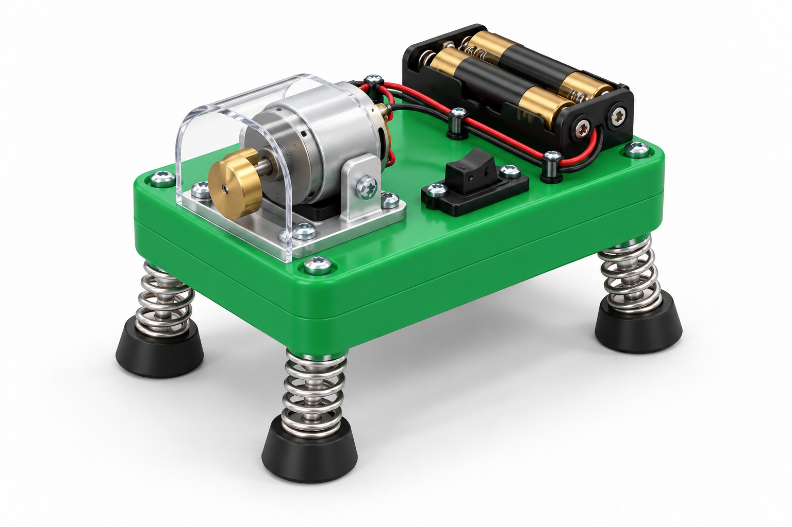

# Springy Wobblebot: vibrating creature

*Illustrative 3D concept render. The purchasable version uses a plain off-the-shelf enclosure, a pre-wired vibration motor, clip leads, and catalog springs rather than a custom-shaped creature body.*

This battery-powered toy demonstrates how an eccentric rotating mass, compliant legs, and ground friction turn vibration into unpredictable motion.

**Status:** procurement-complete rendered concept; **not yet classroom-release ready.** The BOM contains the electronics, enclosure, legs, feet, attachment materials, and batteries required for the proposed 3 V version. A facilitator must complete an electrical and mechanical first article before students use it. See the [build standard](../../docs/BUILD_STANDARD.md).

## What the purchasable version changes

| Rendered feature | No-fabrication implementation |
| --- | --- |
| Sculpted toy body | McMaster factory-molded impact-resistant polycarbonate enclosure |
| Internal custom motor mount | A pre-wired 1.5–3 V vibration motor retained to the enclosure with full cable ties |
| Custom spring feet | Four same-size springs selected from a single identified catalog spring kit; 3M self-adhesive polyurethane bumpers as feet |
| Soldered battery wiring | A switched 2xAA holder with factory alligator clips clamped to the motor’s factory male pins |

## Complete bill of materials — one Wobblebot

| Function | Exact item and purchased configuration | Buy | Use | Direct item link |
| --- | --- | ---: | ---: | --- |
| Body | McMaster-Carr `5257N111`, gray impact-resistant polycarbonate enclosure, 3.75 x 4.5 x 2.25 in. | 1 | 1 | [5257N111](https://www.mcmaster.com/5257N111/) |
| Pre-wired eccentric-mass actuator | Barnabas Robotics `MOT-3-1A`, 1.5–3 V vibrating 130-size DC motor with soldered wires and male 2.54-mm pin connectors | 1 | 1 | [MOT-3-1A](https://shop.barnabasrobotics.com/products/130-size-vibration-dc-motor-pin-connectors-soldered-wires) |
| Switched, solder-free power source | Abra Electronics `BAT-H-2AA-S-C`, transparent 2xAA holder with on/off switch and red/black alligator clips | 1 | 1 | [BAT-H-2AA-S-C](https://abra-electronics.com/batteries-holders/battery-holders-aa-cell/bat-h-2aa-s-clip-battery-holder-2xaa-transparent-with-switch-alligator-clips.html) |
| Battery cells | Energizer `NH15BP-4`, AA nickel-metal-hydride rechargeable battery 4-pack, 1.2 V/cell | 1 pack | 2 cells | [NH15BP-4](https://www.grainger.com/product/ENERGIZER-Rechargeable-Battery-AA-Battery-3KKJ7) |
| Shared charger for repeat sessions | Energizer `CHVCWB2`, overnight AA/AAA NiMH charger kit | 1 shared kit | 1 charger | [CHVCWB2](https://www.batteryproducts.com/P/5229/EnergizerPlug-InBatteryCharger) |
| Four compliant legs | McMaster-Carr `9618K14`, 126-piece compression-spring assortment | 1 kit | 4 matching 1–1.75-in. compression springs from one compartment | [9618K14](https://www.mcmaster.com/9618K14/) |
| Four non-skid feet and motor cushioning | 3M `SJ5012BL`, Bumpon self-adhesive bumper mini-pack | 1 mini-pack | 4 feet + 2 motor cushions | [SJ5012BL](https://www.3m.com/3M/en_US/p/d/v100720225/) |
| Motor, legs, battery holder, and decoration retention | VEX V5 `275-0125`, 11-in. zip ties (100-pack) | 1 pack | 12 full ties | [275-0125](https://www.vexrobotics.com/275-0125.html) |

The `MOT-3-1A` source was listed sold out when this BOM was checked. It is specified because it is an exact low-voltage vibration motor with factory soldered 2.54-mm male pins, allowing the included alligator clips to make the circuit without stripping, crimping, or soldering. Recheck availability before purchase; do not substitute a bare-wire motor unless the connection is redesigned and pilot-tested.

## Item-specific assembly sequence

1. Keep the `BAT-H-2AA-S-C` switch **off**. Install two charged `NH15BP-4` cells in the holder, but do not connect the clips yet. The two-cell nominal supply is 2.4 V and must be recharged only with the shared `CHVCWB2` NiMH charger.
2. Select four springs of the same size from one `9618K14` compartment. Use paired `275-0125` cable ties around the enclosure body and the top coil of each spring to retain four legs. Leave each tie full length; do not trim it.
3. Press one `SJ5012BL` bumper onto the lower end of each spring. Allow the adhesive to set according to the bumper supplier’s handling guidance before a motion test.
4. Place two `SJ5012BL` bumpers on the enclosure top as cushions. Lay `MOT-3-1A` across them and use two full `275-0125` cable ties around the enclosure to prevent motor rotation or translation. Ensure its eccentric mass can rotate without touching any tie, wall, or hand.
5. Retain the battery holder against one enclosure side with two additional full cable ties. Clamp its red alligator clip to the motor’s positive-marked male pin and its black clip to the other motor pin. The exposed clips must not touch each other or any conductive part.
6. Place the bot on a clear, smooth floor or tray. Turn the switch on for a 5 s supervised trial, then off before changing legs, feet, or cable-tie position.

## First-article checks before release

- Use only the specified two-cell `NH15BP-4` NiMH arrangement (2.4 V nominal), which lies within the motor’s 1.5–3 V specified range. This design excludes USB supplies, wall supplies, alkaline cells, and battery types other than the specified 2xAA NiMH arrangement.
- With power off, rotate the eccentric mass by hand; it must clear the enclosure, ties, clips, springs, and student-accessible edges.
- Run five 10 s trials on a floor tray. Inspect cable-tie retention, bumper adhesion, clip grip, wire insulation, and enclosure temperature after each trial. Remove the build from use if a clip loosens, a wire is damaged, or the motor is hot to touch.

## Physics prompt

The rotating offset mass creates a periodic force with magnitude that scales approximately as \(F\approx m e \omega^2\), where \(m\) is eccentric mass, \(e\) is offset, and \(\omega\) is angular speed. Motion across the floor depends on friction and how vibration couples to the spring legs; it need not increase monotonically with offset.
